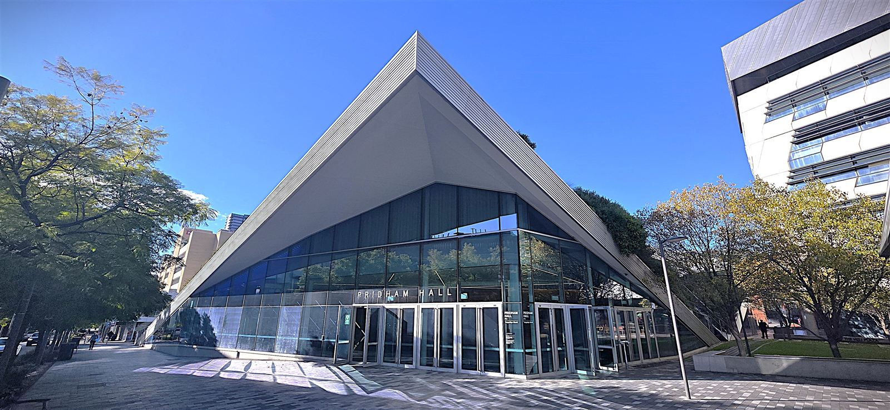
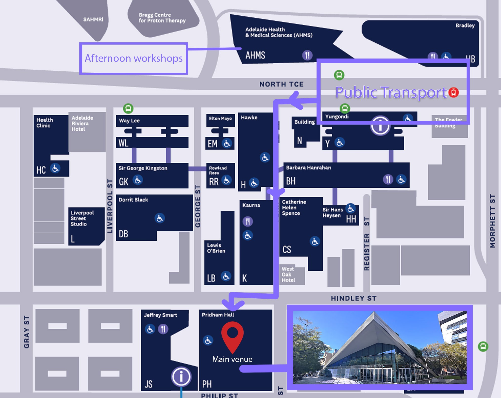
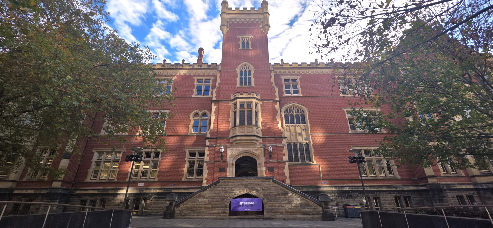
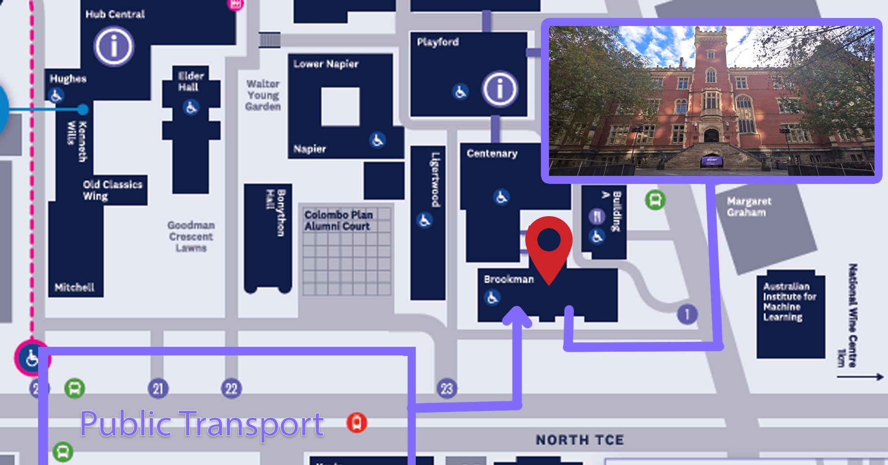

```{=html}
<div class="program-intro">
  The Adelaide School runs across two Adelaide University campuses. Day One is at City West, Day Two at City East. Tap a map to open it full size, or download it for offline use.
</div>

<div class="day-switcher" role="tablist">
  <button class="day-btn active" data-day="day1" role="tab">Day 1 · Nov 12</button>
  <button class="day-btn" data-day="day2" role="tab">Day 2 · Nov 13</button>
</div>

<!-- DAY ONE -->
<div class="day-content active" id="day1">
  <div class="prog-venue">
    
    <div class="prog-venue-inner">
      <div class="prog-venue-eyebrow">Day One · Nov 12 · City West campus</div>
      <div class="prog-venue-name">Pridham Hall</div>
      <a class="prog-map-link" href="images/maps/CW-Map.jpg" download="Adelaide-School-Day1-City-West-Map.jpg">Download campus map ↓</a>
    </div>
  </div>
  <figure class="campus-map">
    <a href="images/maps/CW-Map.jpg" target="_blank" rel="noopener">
      
    </a>
    <figcaption>City West campus · open full size ↗</figcaption>
  </figure>
</div>

<!-- DAY TWO -->
<div class="day-content" id="day2">
  <div class="prog-venue">
    
    <div class="prog-venue-inner">
      <div class="prog-venue-eyebrow">Day Two · Nov 13 · City East campus</div>
      <div class="prog-venue-name">Brookman Hall</div>
      <a class="prog-map-link" href="images/maps/CE-Map.jpg" download="Adelaide-School-Day2-City-East-Map.jpg">Download campus map ↓</a>
    </div>
  </div>
  <figure class="campus-map">
    <a href="images/maps/CE-Map.jpg" target="_blank" rel="noopener">
      
    </a>
    <figcaption>City East campus · open full size ↗</figcaption>
  </figure>
</div>

<script>
document.querySelectorAll('.day-switcher .day-btn').forEach(function (btn) {
  btn.addEventListener('click', function () {
    document.querySelectorAll('.day-switcher .day-btn').forEach(function (b) { b.classList.toggle('active', b === btn); });
    document.querySelectorAll('.day-content').forEach(function (c) { c.classList.toggle('active', c.id === btn.dataset.day); });
  });
});
</script>
```
